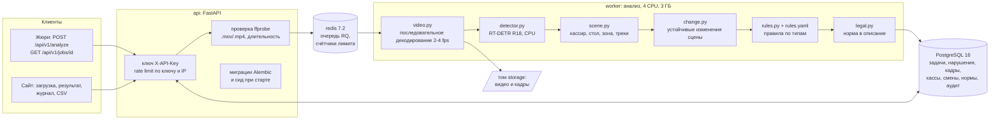

# Архитектура ForteGuard

Всё работает на одной машине без GPU и без интернета. Внешних API, облачных моделей и распознавания лиц нет:
детектор видит человека как объект, личность не устанавливается.

## Компоненты

## Поток обработки видео

1. `POST /api/v1/analyze`: ключ, лимит запросов, приём файла потоком с ограничением размера, SHA-256,
   проверка контейнера и наличия видеопотока через `ffprobe`. Создаётся `Job`, задача уходит в очередь.
2. Воркер (`tasks.run_job` → `analyzer.analyze` → `ml/pipeline.py`):
   - **Декодирование** (`video.py`): только последовательное чтение (позиционирование по времени
     на части роликов с телефона отдаёт пустые кадры). Частота 2–4 кадра/с, выбирается по длительности:
     ~360 кадров на ролик, ролик 145 с обрабатывается за ~1,8 мин на 4 ядрах.
   - **Детекция** (`detector.py`): RT-DETR R18-vd (Apache-2.0) через `transformers`, вход с сохранением пропорций
     (длинная сторона 640, для вертикального видео 352×640). Классы: человек и предметы COCO.
     Для каждой детекции дополнительно считаются средние HSV и доля белых пикселей.
   - **Сцена** (`scene.py`) без ручной разметки: кассир = самый «долгий и крупный» трек;
     стол = устойчивые предметы рядом с кассиром (ноутбук, счётчик, телефон); рабочая зона = стол + место кассира
     с запасом, пропорциональным росту кассира. Люди за стеклянными стенами отсекаются по глубине
     (ноги дальше края стола) и по неподвижности вне зоны стола. Затем трекинг людей (жадный IoU, свой код).
   - **Изменения сцены** (`change.py`): медиана открытых (не закрытых людьми) пикселей в начале клипа против
     текущего окна 1,5 с, с нормализацией освещения; выключение света не считается изменением.
   - **Правила** (`rules.py`, пороги в `rules.yaml`, все размеры в долях роста кассира, а не в пикселях):
     толпа (3+ человека), вход с открытой дверью, устойчиво открытая дверь у стола, вход клиента при открыто
     лежащих пачках, короткий визит (сдал сумку и ушёл, или ушёл до конца пересчёта), уход кассира из кассы.
     Близкие события сливаются, остаётся самое сильное.
   - **Описание и норма** (`legal.py`): описание говорит только о видимом и заканчивается
     «Норма: <документ>, <пункт>.»; непроверенные пункты помечены «(требует проверки)».
3. Кадры-доказательства: t, t+1, t+2 с, тем же последовательным чтением, JPEG в том `storage`.
4. Кассир по смене: если при загрузке указаны касса и время начала записи, `find_teller` находит смену.
5. `GET /api/v1/jobs/{id}` отдаёт ответ строго по схеме кейса (`schemas.py` не менялась).

## Данные

| Таблица | Назначение |
|---|---|
| `jobs` | загрузки: статус, прогресс, вердикт, SHA-256 файла, касса, время записи, версия модели |
| `violations` | нарушения: тип, таймкод, описание, норма, кассир, статус проверки, комментарий |
| `evidence_frames` | пути к кадрам-доказательствам |
| `violation_types`, `legal_rules` | таксономия и нормы из `seed/legal_rules.json` (синхронизируются при каждом старте) |
| `desks`, `employees`, `shifts` | кассы, сотрудники (без фото и биометрии), смены |
| `audit_log` | загрузки и изменения статусов |

Схема меняется только миграциями Alembic (`backend/migrations`). База, созданная первым каркасом
без Alembic, при первом старте помечается ревизией 0001 и обновляется без потери данных.

## Безопасность

- Ключ API только из `.env`; с пустым или примерным ключом сервис не стартует. Сравнение ключа за постоянное время.
- Rate limit на `/api/v1/analyze`: окно в минуту на пару «ключ + IP» в Redis (в счётчике хеш, а не сам ключ).
- Заголовки: CSP `default-src 'self'` без inline-скриптов и стилей, `X-Content-Type-Options: nosniff`,
  `X-Frame-Options: DENY`, `Referrer-Policy: no-referrer`, `Permissions-Policy`, `Cache-Control: no-store` для API.
- CORS выключен (только свой origin); дополнительные origin задаются явно в `CORS_ORIGINS`.
- Ошибки наружу без стектрейсов: 500 → `{"detail": "Internal error"}`, ошибки валидации без эха значений;
  трейс задачи хранится в БД для оператора и в API не возвращается.
- Проверка контейнера `ffprobe`, лимит размера и длительности, имена файлов на диске генерируются сервером.
- CSV-экспорт защищён от формул (ячейки, начинающиеся с `= + - @`, экранируются).
- Воркер ограничен по CPU и памяти; Redis без записи на диск (tmpfs).
- `pip-audit` в CI.

## Производительность

| Шаг | Время на кадр (4 потока) |
|---|---|
| RT-DETR 352×640 | ~0,28 с |
| сцена, изменения, правила | < 1 с на ролик |

Ролик 145 с: ~360 кадров, ~106 с на 4 ядрах (`OMP_NUM_THREADS=4`, без других нагрузок).
Ролики длиннее 3 минут обрабатываются с частотой ниже 2 кадров/с, чтобы уложиться в лимит 5 минут.
